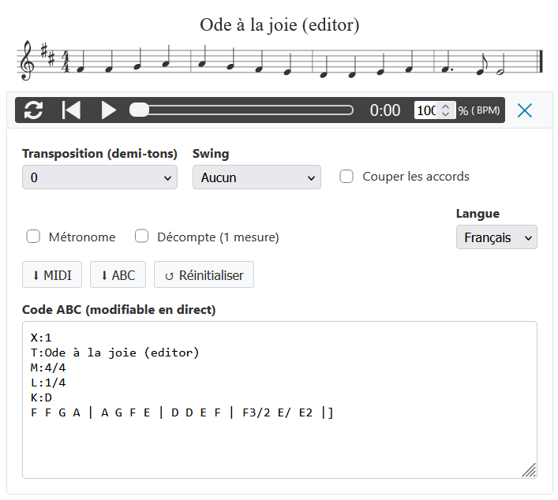
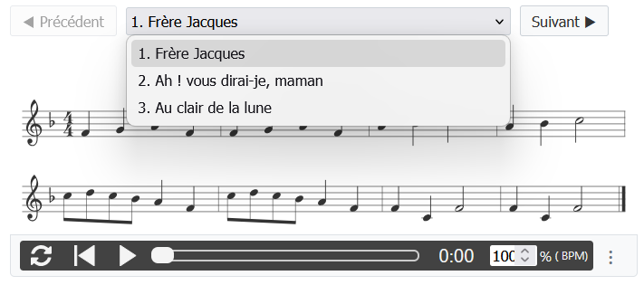
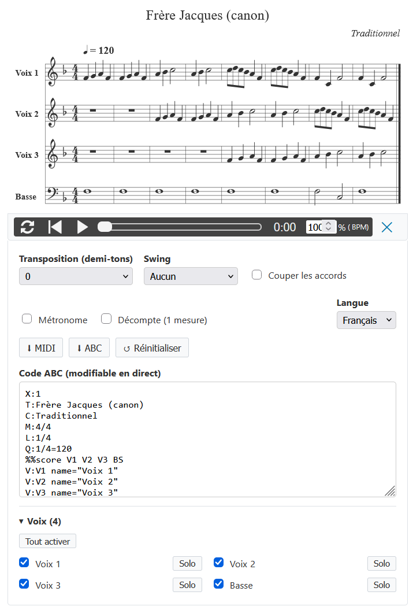
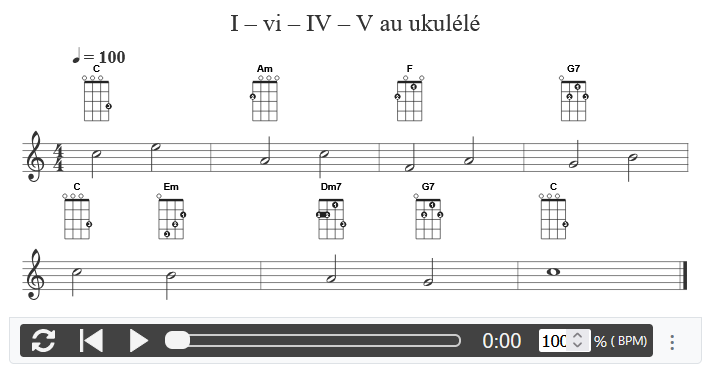

# abcjs-fx

[🇬🇧 English version](README.md) · [📖 Documentation et exemples en direct](https://fxpar.github.io/abcjs-fx/#/fr/)

<p align="center"></p>

**Un lecteur et éditeur de musique ABC prêt à l'emploi, basé sur [abcjs](https://www.abcjs.net/).**
Écrivez un morceau en notation ABC dans un `<textarea>` ; abcjs-fx le transforme en partition avec
lecteur audio, menu de recueil et outils de travail. Aucune compilation, aucune dépendance autre qu'abcjs.

```html
<script src="https://cdn.jsdelivr.net/npm/abcjs@6.7.2/dist/abcjs-basic-min.js"></script>
<link rel="stylesheet" href="https://cdn.jsdelivr.net/npm/abcjs@6.7.2/abcjs-audio.css">
<script src="https://cdn.jsdelivr.net/gh/fxpar/abcjs-fx@v9.1.0/src/abcjs-fx.js"></script>

<textarea data-abcjs-fx>
X:1
T:Au clair de la lune
M:4/4
L:1/4
K:C
"C"C C C D | "G7"E2 D2 | "C"C E "G7"D D | "C"C4 |]
</textarea>
```

## Fonctionnalités

### Partition, audio et outils de travail

* **Partition + audio** — synthétiseur, curseur animé, clic sur la partition pour lancer / suspendre,
  clic sur une note pour y sauter.
* **Outils de travail** — transposition (partition, son et noms d'accords), swing, accords coupés,
  métronome, décompte d'une mesure (joué une seule fois en boucle).
* **Éditeur en direct** — la partition suit la frappe ; les avertissements d'abcjs sont listés.
* **Export** — MIDI (ce que vous entendez), ABC du morceau, recueil complet avec vos modifications.
* **Modes d'affichage** — `editor`, `audio`, `midi` (lecteur seul), `paper` (partition seule).
* **Tablature** — numéros de case sur fond blanc, lisibles partout ; patch facultatif pour les
  **accordages rentrants** (ukulélé à Sol aigu, banjo) qu'abcjs refuse seul.
* **Interface en français / anglais** — langue du navigateur détectée, menu de langue dans le lecteur
  (mémorisé), infobulles de la barre audio d'abcjs traduites ; extensible à d'autres langues.

### Recueils

Plusieurs morceaux `X:` dans un même textarea donnent un menu précédent / suivant ; un en-tête commun
s'applique à tous les morceaux, et coller un recueil entier dans l'éditeur ajoute ses morceaux.

<p align="center"></p>

### Voix : couper et solo

Chaque voix d'une partition à plusieurs voix peut être coupée ou écoutée seule, depuis un accordéon en
bas du panneau d'options.

<p align="center"></p>

### Diagrammes d'accords (extension)

Les diagrammes sont dessinés à la place des noms d'accords et suivent la transposition ; la forme se
change accord par accord, et les accords absents de la bibliothèque reçoivent des formes calculées.

<p align="center"></p>

## Fichiers

| Fichier | Rôle |
|---|---|
| [`src/abcjs-fx.js`](src/abcjs-fx.js) | le lecteur (CSS inclus) |
| [`src/abcjs-fx-diagrams.js`](src/abcjs-fx-diagrams.js) | extension facultative des diagrammes d'accords |
| [`src/chord-library.js`](src/chord-library.js) | formes d'accords ukulélé et guitare utilisées par l'extension (~115 Ko) |
| [`src/abcjs-reentrant-tab.js`](src/abcjs-reentrant-tab.js) | patch abcjs facultatif : accordages rentrants en tablature (fonctionne aussi sans abcjs-fx) |
| [`docs/`](docs/) | site de documentation ([Docsify](https://docsify.js.org)), publié avec GitHub Pages |
| [`examples/`](examples/) | une page autonome pour essayer les sources en local |
| [`images/`](images/) | captures d'écran utilisées dans ce README |

Nécessite **abcjs 6.4 ou plus récent** (testé avec 6.7.2).

## Documentation

**https://fxpar.github.io/abcjs-fx/#/fr/** — une page par fonctionnalité, chacune avec un exemple en
direct, en français et en anglais.

Pour la consulter en local, servez le dossier `docs/` avec n'importe quel serveur statique, par exemple :

```bash
npx docsify-cli serve docs
```

ou `python -m http.server --directory docs`, puis ouvrez http://localhost:8000.

## Développement

Les sources sont de simples scripts navigateur : il n'y a rien à compiler. Après une modification de
`src/`, recopiez les fichiers utilisés par la documentation :

```bash
npm run sync-docs
```

`npm run check` vérifie la syntaxe des sources.

## WordPress

Le [plugin ABC Notation](https://github.com/fxpar/abcjs-wp-plugin) (version 7) utilise abcjs-fx.

## Licence

[MIT](LICENSE). abcjs est © Paul Rosen et contributeurs, licence MIT.
