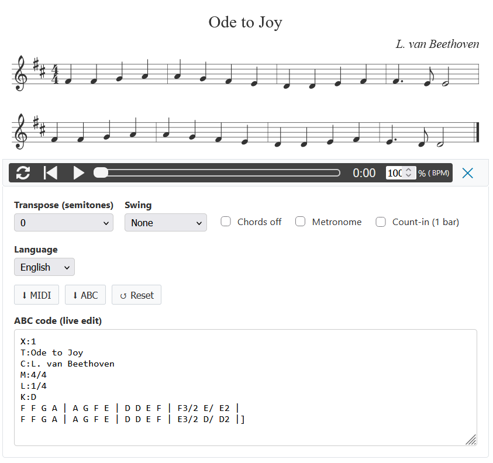
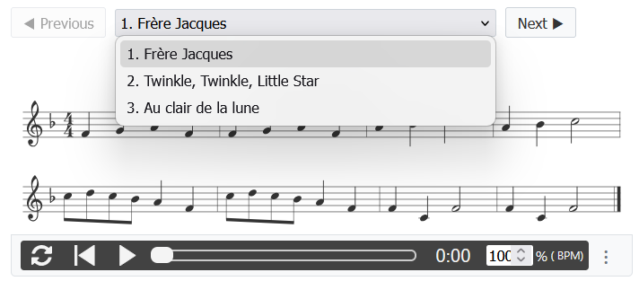
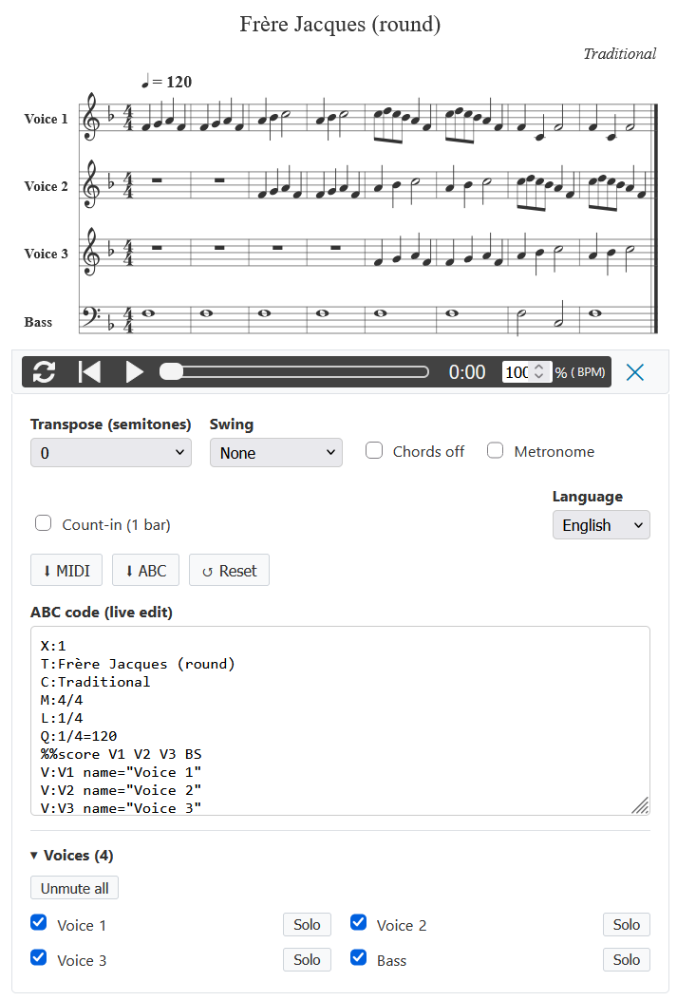
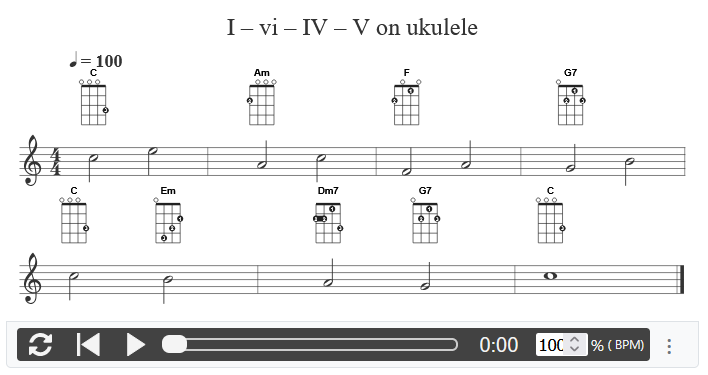

# abcjs-fx

[🇫🇷 Version française](README.fr.md) · [📖 Documentation & live examples](https://fxpar.github.io/abcjs-fx/)

<p align="center"></p>

**A drop-in ABC music player and editor built on [abcjs](https://www.abcjs.net/).**
Write a tune in ABC notation inside a `<textarea>`; abcjs-fx turns it into sheet music with an audio
player, a tunebook menu and practice tools. No build step, no dependency other than abcjs.

```html
<script src="https://cdn.jsdelivr.net/npm/abcjs@6.7.2/dist/abcjs-basic-min.js"></script>
<link rel="stylesheet" href="https://cdn.jsdelivr.net/npm/abcjs@6.7.2/abcjs-audio.css">
<script src="https://cdn.jsdelivr.net/gh/fxpar/abcjs-fx@v9.0.0/src/abcjs-fx.js"></script>

<textarea data-abcjs-fx>
X:1
T:Au clair de la lune
M:4/4
L:1/4
K:C
"C"C C C D | "G7"E2 D2 | "C"C E "G7"D D | "C"C4 |]
</textarea>
```

## Features

### Score, audio and practice tools

* **Score + audio** — synthesizer, animated cursor, click the score to play / pause, click a note to jump.
* **Practice tools** — transposition (score, sound and chord names), swing, chords off, metronome,
  one-bar count-in (played once in loop mode).
* **Live editor** — the score follows your typing; abcjs warnings are listed.
* **Export** — MIDI (what you hear), ABC of the tune, whole tunebook with your edits.
* **Display modes** — `editor`, `audio`, `midi` (player only), `paper` (score only).
* **Tablature** — fret numbers on a white background, readable everywhere.
* **French / English interface** — browser language detected, language menu in the player (remembered),
  abcjs audio-bar tooltips translated; extensible to other languages.

### Tunebooks

Several `X:` tunes in one textarea get a previous / next menu; a shared file header applies to every
tune, and pasting a whole book into the editor adds its tunes.

<p align="center"></p>

### Voices: mute and solo

Every voice of a multi-voice score can be muted or played alone, from an accordion at the bottom of the
options panel.

<p align="center"></p>

### Chord diagrams (extension)

Diagrams are drawn in place of the chord names and follow the transposition; shapes can be changed chord
by chord, and chords missing from the library get computed shapes.

<p align="center"></p>

## Files

| File | Role |
|---|---|
| [`src/abcjs-fx.js`](src/abcjs-fx.js) | the player (CSS included) |
| [`src/abcjs-fx-diagrams.js`](src/abcjs-fx-diagrams.js) | optional chord diagrams extension |
| [`src/chord-library.js`](src/chord-library.js) | ukulele & guitar chord shapes used by the extension (~115 kB) |
| [`docs/`](docs/) | documentation site ([Docsify](https://docsify.js.org)), published with GitHub Pages |
| [`examples/`](examples/) | a standalone page to try the sources locally |
| [`images/`](images/) | screenshots used in this README |

Requires **abcjs 6.4 or later** (tested with 6.7.2).

## Documentation

**https://fxpar.github.io/abcjs-fx/** — one page per feature, each with a live example, in English and French.

To preview it locally, serve the `docs/` folder with any static server, for example:

```bash
npx docsify-cli serve docs
```

or `python -m http.server --directory docs`, then open http://localhost:8000.

## Development

The sources are plain browser scripts, there is nothing to build. After changing `src/`, copy the files
used by the documentation:

```bash
npm run sync-docs
```

`npm run check` checks the syntax of the sources.

## WordPress

The [ABC Notation plugin](https://github.com/fxpar/abcjs-wp-plugin) (version 7) uses abcjs-fx.

## License

[MIT](LICENSE). abcjs is © Paul Rosen and contributors, MIT license.
